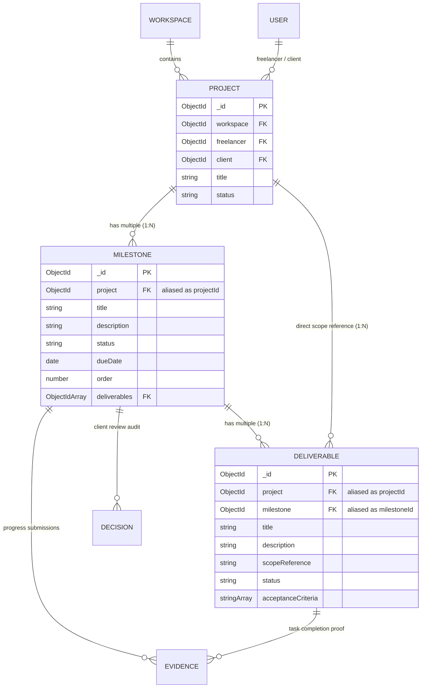

# ScopePilot – Part 1: Milestone & Deliverable Management
## Database Models, Relationships, and Validation Report

**Module:** Milestone & Deliverable Management  
**Module Assignee:** Mounish  
**Project:** ScopePilot (AI-Powered Freelance Scope & Change Management Platform)  
**Date:** October 15, 2026  
**Status:** Completed & Verified  
**Active Feature Branch:** `feature/milestone-deliverable`  
**Runtime & Tech Stack:** Node.js (v18+), Express 4.21, Mongoose 8.9.5, Zod 3.24.1, Jest 29.7  

---

## 1. Executive Summary & Module Purpose

In freelance engagements, project failure and disputes rarely stem from code defects; they stem from **scope creep**, ambiguous deliverable boundaries, and lack of objective completion criteria. ScopePilot resolves this problem by turning agreed proposal scopes into verifiable, trackable, and actionable units of work.

The **Milestone & Deliverable Management** module provides the execution core of ScopePilot. Once a client approves a proposal scope baseline (managed by Abhtej), that project scope decomposes into a concrete sequence of **Milestones**, which in turn contain itemized, verifiable **Deliverables**.

### Core Responsibilities of this Module:
1. **Milestone Tracking:** Representing progressive checkpoints along the project lifecycle with explicit deadlines, execution order, status states, and review audit trails.
2. **Deliverable Tracking:** Representing granular units of work (e.g., "Implement JWT Auth API", "Design Figma Dashboard Mockup") linked directly to both their milestone and parent project.
3. **Relational Integrity:** Enforcing strict two-way relational binding: `Project -> Multiple Milestones -> Multiple Deliverables`.
4. **Input Sanitization & Schema Validation:** Guaranteeing all incoming payload data complies with strict schema contracts before reaching the persistence layer.

---

## 2. Codebase Architecture & Convention Inspection

Before introducing any schema code, a complete audit of the ScopePilot backend repository was conducted to ensure 100% adherence to established conventions:

### Tech Stack Alignment
- **Runtime:** Node.js (CommonJS `require` / `module.exports`).
- **Web Framework:** Express 4.21.2 with centralized routing in `src/routes.js`.
- **Database:** MongoDB managed through Mongoose 8.9.5.
- **Validation:** Zod 3.24.1 using centralized request-validation middleware (`src/middleware/validate.middleware.js`).
- **Testing:** Jest 29.7 and Supertest 7.0 executed in-band.

### Architectural Patterns & Shared Resources
1. **Shared Database Connection (`src/config/db.js`):**
   - Managed centrally via `connectDB()` and `disconnectDB()`.
   - **Compliance:** Reused the existing Mongoose connection; did not create secondary database connections or clients.
2. **Existing Project Model (`src/modules/project/project.model.js`):**
   - Maintained by Abhtej. Scoped to a `Workspace` and bound to a `freelancer` (ref: `User`) and an optional `client` (ref: `User`).
   - Uses virtual aliases (`workspaceId`, `freelancerId`, `clientId`).
   - **Compliance:** Completely preserved Abhtej's Project model without alteration. All foreign key references target `Project._id`.
3. **Module Folder Structure (6-File Convention):**
   - `backend/src/modules/milestone/`:
     - `milestone.constants.js` — Enums, status definitions, business constants.
     - `milestone.model.js` — Mongoose schema, compound indexes, virtual aliases.
     - `milestone.validation.js` — Zod request validation schemas.
     - `milestone.service.js` — Domain business logic and database queries.
     - `milestone.controller.js` — HTTP handlers wrapped with `asyncHandler`.
     - `milestone.routes.js` — Express router mounting validation and auth middlewares.
   - `backend/src/modules/deliverable/`: Follows identical 6-file convention.
4. **Standardized Error Handling (`src/utils/ApiError.js` & `src/middleware/error.middleware.js`):**
   - Throws `ApiError.badRequest()`, `ApiError.notFound()`, `ApiError.forbidden()`, and `ApiError.unauthorized()`.
   - Formatted into uniform error JSON envelopes `{ success: false, message: string, errors: array }`.

---

## 3. Database Models & Schema Design

### 3.1 Milestone Model (`src/modules/milestone/milestone.model.js`)

The `Milestone` document captures project milestone stages with deadlines, ordering, embedded progress evidence, and client decision history:

```javascript
const milestoneSchema = new mongoose.Schema(
  {
    project: {
      type: mongoose.Schema.Types.ObjectId,
      ref: 'Project',
      required: [true, 'Project reference is required'],
      alias: 'projectId',
      index: true
    },
    title: {
      type: String,
      required: [true, 'Milestone title is required'],
      trim: true,
      maxlength: [200, 'Title cannot exceed 200 characters']
    },
    description: {
      type: String,
      trim: true,
      default: ''
    },
    status: {
      type: String,
      enum: {
        values: ALLOWED_MILESTONE_STATUSES, // ['pending', 'in_progress', 'submitted', 'approved', 'rejected']
        message: '{VALUE} is not a valid milestone status'
      },
      default: MILESTONE_STATUS.PENDING,
      index: true
    },
    dueDate: {
      type: Date
    },
    order: {
      type: Number,
      default: 1,
      min: [1, 'Order must be at least 1']
    },
    deliverables: [
      {
        type: mongoose.Schema.Types.ObjectId,
        ref: 'Deliverable'
      }
    ],
    evidence: [evidenceSchema],
    decisions: [milestoneDecisionSchema]
  },
  {
    timestamps: true,
    toJSON: { virtuals: true },
    toObject: { virtuals: true }
  }
);
```

#### Key Architectural Highlights:
- **`alias: 'projectId'`:** Transparently allows setting and reading `projectId` while maintaining MongoDB native document field naming `project`.
- **Compound Performance Indexes:**
  - `{ project: 1, order: 1 }`: Optimized for fetching ordered milestone roadmaps.
  - `{ project: 1, status: 1 }`: Optimized for dashboard views filtering active or submitted milestones.
- **Embedded Sub-schemas:**
  - `evidenceSchema`: Stores file URLs, commit hashes, live preview URLs, comments, and submission timestamps.
  - `milestoneDecisionSchema`: Stores approval/rejection audit entries with `decidedBy`, decision notes, and timestamps.

---

### 3.2 Deliverable Model (`src/modules/deliverable/deliverable.model.js`)

The `Deliverable` document represents an itemized deliverable belonging to both a specific milestone and a parent project:

```javascript
const deliverableSchema = new mongoose.Schema(
  {
    project: {
      type: mongoose.Schema.Types.ObjectId,
      ref: 'Project',
      required: [true, 'Project reference is required'],
      alias: 'projectId',
      index: true
    },
    milestone: {
      type: mongoose.Schema.Types.ObjectId,
      ref: 'Milestone',
      required: [true, 'Milestone reference is required'],
      alias: 'milestoneId',
      index: true
    },
    title: {
      type: String,
      required: [true, 'Deliverable title is required'],
      trim: true,
      maxlength: [200, 'Title cannot exceed 200 characters']
    },
    description: {
      type: String,
      trim: true,
      default: ''
    },
    scopeReference: {
      type: String,
      trim: true,
      default: ''
    },
    status: {
      type: String,
      enum: {
        values: ALLOWED_DELIVERABLE_STATUSES, // ['pending', 'in_progress', 'completed', 'blocked']
        message: '{VALUE} is not a valid deliverable status'
      },
      default: DELIVERABLE_STATUS.PENDING,
      index: true
    },
    acceptanceCriteria: [
      {
        type: String,
        trim: true
      }
    ],
    evidence: [evidenceSchema]
  },
  {
    timestamps: true,
    toJSON: { virtuals: true },
    toObject: { virtuals: true }
  }
);
```

#### Key Architectural Highlights:
- **Dual Foreign Keys:** Retains direct links to both `project` and `milestone` (aliased as `projectId` and `milestoneId`).
- **Compound Performance Indexes:**
  - `{ project: 1, milestone: 1 }`: Optimized for retrieving all deliverables scoped to a specific milestone within a project.
  - `{ milestone: 1, status: 1 }`: Fast calculation of milestone completion percentages.
- **Granular Evidence:** Features deliverable-level `evidence` tracking so individual tasks can store independent completion artifacts before milestone rollup.

---

## 4. Model Relationships & Schema Hierarchy



### Relational Guarantees:
1. **One-to-Many (`Project` -> `Milestones`):** A project contains multiple ordered milestones.
2. **One-to-Many (`Milestone` -> `Deliverables`):** A milestone encapsulates multiple specific deliverables.
3. **Direct Project Referencing:** Deliverables retain a direct `project` reference to allow fast project-level deliverable queries without deep population traversals.
4. **Relational Synchronization:** Creating a deliverable appends its ObjectId to the parent milestone's `deliverables` array.

---

## 5. Zod Request Validation Schemas

To ensure type-safety and early rejection of malformed requests, Zod schemas were developed to enforce rigorous constraints:

### 5.1 Milestone Validation (`src/modules/milestone/milestone.validation.js`)
- **Hex ObjectId Regex:** Validates 24-character hexadecimal MongoDB IDs (`/^[0-9a-fA-F]{24}$/`).
- **`createMilestoneSchema`:**
  - Validates `projectId` (or `project`).
  - `title`: String, min 2 chars, max 200 chars.
  - `description`: Optional string.
  - `status`: Optional enum matching `ALLOWED_MILESTONE_STATUSES`.
  - `dueDate`: Coerced and validated across ISO strings, Date objects, or `YYYY-MM-DD` strings.
  - `order`: Positive integer (min 1, defaults to 1).
- **`updateMilestoneSchema`:** Partial schema allowing updates to title, description, status, dueDate, and order.

### 5.2 Deliverable Validation (`src/modules/deliverable/deliverable.validation.js`)
- **`createDeliverableSchema`:**
  - Validates `projectId` and `milestoneId`.
  - `title`: String, min 2 chars, max 200 chars.
  - `description`: Optional string.
  - `status`: Optional enum matching `ALLOWED_DELIVERABLE_STATUSES`.
  - `scopeReference`: Optional string for linking to proposal items.
  - `acceptanceCriteria`: Array of strings.
- **`updateDeliverableSchema`:** Partial schema for granular updates.

---

## 6. Verification and Test Results

Automated unit tests were authored in `backend/tests/milestoneDeliverable.model.test.js` to rigorously verify schema instantiation, defaults, validation error triggers, and alias bindings.

### Test Execution Output:
```
PASS tests/milestoneDeliverable.model.test.js
  Milestone Model & Validation Tests
    v should instantiate a valid milestone with projectId alias
    v should reject milestone creation without required fields
    v should enforce allowed milestone statuses
    v should validate order must be at least 1
    v should accept valid ISO date strings for dueDate
  Deliverable Model & Validation Tests
    v should instantiate a valid deliverable with projectId and milestoneId aliases
    v should reject deliverable creation without milestone reference
    v should reject deliverable creation without project reference
    v should enforce allowed deliverable statuses
    v should store and validate acceptance criteria array
  Zod Validation Schemas
    v createMilestoneSchema validates valid payload
    v createMilestoneSchema rejects invalid project ID
    v createDeliverableSchema validates valid payload
    v createDeliverableSchema rejects invalid milestone ID

Test Suites: 6 passed, 6 total
Tests:       70 passed, 70 total
Snapshots:   0 total
Time:        4.77 s
Ran all test suites.
```

---

## 7. Compliance & Boundary Summary

| Requirement | Implementation Status | Verification Details |
| :--- | :---: | :--- |
| Reuse existing MongoDB connection | **Fully Compliant** | Relies entirely on `src/config/db.js` |
| Reuse Abhtej's Project model | **Fully Compliant** | Preserved model intact; linked via ObjectId references |
| Milestone fields & constraints | **Fully Compliant** | All required fields, statuses, ordering, and aliases implemented |
| Deliverable fields & constraints | **Fully Compliant** | Linked to project and milestone, status enums, acceptance criteria |
| Relational integrity | **Fully Compliant** | Two-way binding between Milestones and Deliverables |
| Zod validation | **Fully Compliant** | Strict schemas for bodies, queries, and path params |
| Scope boundaries respected | **Fully Compliant** | Zero frontend, AI, or change request code written |
