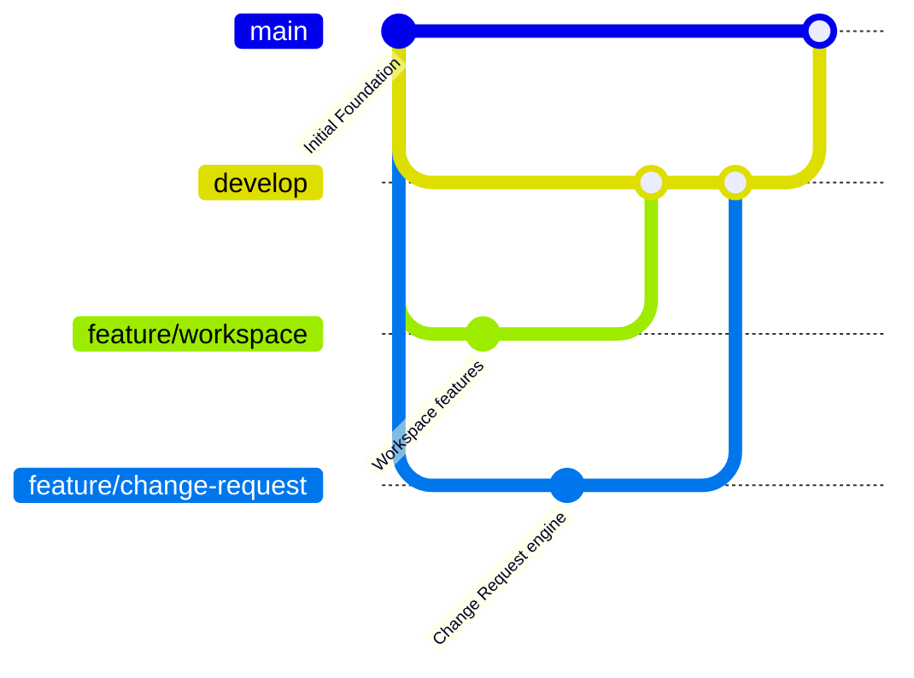

# ScopePilot Backend Foundation

Production-oriented backend foundation for **ScopePilot** — an AI-powered freelance scope and change management platform.

---

## 📋 Table of Contents

- [Requirements](#requirements)
- [Installation](#installation)
- [Environment Setup](#environment-setup)
- [Running Development Server](#running-development-server)
- [MongoDB Setup & Seeding](#mongodb-setup--seeding)
- [Folder Structure](#folder-structure)
- [API Architecture & Endpoints](#api-architecture--endpoints)
- [Module Development Guidelines](#module-development-guidelines)
- [Git Workflow & Branching](#git-workflow--branching)
- [Error Handling & Response Envelope](#error-handling--response-envelope)
- [Request Validation with Zod](#request-validation-with-zod)
- [Authentication & Authorization](#authentication--authorization)
- [Testing](#testing)
- [Future AI Integration](#future-ai-integration)

---

## Requirements

- **Node.js**: `v18.0.0` or higher (tested with `v24.x`)
- **npm**: `v9.x` or higher
- **MongoDB**: Local MongoDB community server (`mongodb://localhost:27017`) or MongoDB Atlas URI

---

## Installation

Navigate to the `backend` directory and install project dependencies:

```bash
cd backend
npm install
```

---

## Environment Setup

Create a `.env` file from `.env.example`:

```bash
cp .env.example .env
```

### Environment Variables

| Variable | Description | Default |
| :--- | :--- | :--- |
| `PORT` | HTTP Server port | `5000` |
| `NODE_ENV` | Runtime environment (`development`, `test`, `production`) | `development` |
| `API_PREFIX` | Base prefix for all API routes | `/api` |
| `MONGODB_URI` | MongoDB connection connection string | `mongodb://localhost:27017/scopepilot_dev` |
| `JWT_SECRET` | Secret key for signing JSON Web Tokens (min 16 chars) | `default_development_jwt_secret...` |
| `JWT_EXPIRES_IN`| Token lifespan | `7d` |
| `CORS_ORIGIN` | Allowed CORS origins (comma-separated or `*`) | `*` |

---

## Running Development Server

Start the server in watch mode (auto-reloads on file changes):

```bash
npm run dev
```

Or run standard production start:

```bash
npm start
```

Verify the server is running by opening:
- Health Check: `http://localhost:5000/api/health`

---

## MongoDB Setup & Seeding

Ensure your local MongoDB service is running:

```bash
# macOS (Homebrew)
brew services start mongodb-community
```

Populate the database with initial development entities (users, workspace, project, approved proposal version, milestone, deliverable):

```bash
npm run seed
```

### Seeded Test Accounts (Local Development Only)

The development seed script (`npm run seed`) provisions three local development accounts:
- **Freelancer:** `freelancer@scopepilot.dev`
- **Client:** `client@scopepilot.dev`
- **Admin:** `admin@scopepilot.dev`

Passwords can be configured for local development via the `SEED_DEFAULT_PASSWORD` environment variable. If omitted in local development, the seed script falls back to the development default configured for local test runners. Never deploy seed scripts or default development credentials to production or publicly accessible environments.

---

## Folder Structure

```
backend/
├── src/
│   ├── config/
│   │   ├── db.js                 # MongoDB Mongoose connection & lifecycle
│   │   └── env.js                # Zod-validated environment config
│   │
│   ├── constants/
│   │   ├── httpStatus.js         # HTTP status code enums
│   │   └── roles.js              # User and Workspace roles
│   │
│   ├── middleware/
│   │   ├── auth.middleware.js     # requireAuth, requireRole, optionalAuth
│   │   ├── error.middleware.js    # Centralized error handler
│   │   ├── notFound.middleware.js # 404 handler
│   │   └── validate.middleware.js # Reusable Zod schema validator (body, params, query)
│   │
│   ├── modules/
│   │   ├── auth/                 # User authentication & registration
│   │   ├── workspace/            # Workspace management, invitations & members
│   │   ├── project/              # Projects under workspaces
│   │   ├── proposal/             # Versioned proposals & approvals
│   │   ├── milestone/            # Milestones & evidence submissions
│   │   ├── deliverable/          # Project deliverables & scope references
│   │   └── changeRequest/        # Change requests & impact analysis
│   │
│   ├── ai/                       # Extension points for RAG, Atlas Vector Search & Agents
│   │   ├── README.md
│   │   ├── rag/
│   │   ├── embeddings/
│   │   ├── agents/
│   │   ├── tools/
│   │   └── prompts/
│   │
│   ├── utils/
│   │   ├── apiResponse.js        # Standard success response builder
│   │   ├── apiError.js           # Standard operational ApiError
│   │   ├── asyncHandler.js       # Async wrapper for route controllers
│   │   └── jwt.js                # JWT sign / verify utilities
│   │
│   ├── scripts/
│   │   └── seed.js               # Development database seeder
│   │
│   ├── routes.js                 # Central API route index
│   ├── app.js                    # Express application configuration
│   └── server.js                 # Server bootstrapper & DB initializer
│
├── tests/
│   ├── health.test.js
│   ├── validation.test.js
│   └── notFound.test.js
│
├── .env.example
├── .gitignore
├── package.json
└── README.md
```

---

## API Architecture & Endpoints

All endpoints are prefixed with `/api`.

### Base & Health
- `GET /api/health` — Service health check

### Auth Module (`/api/auth`)
- `POST /api/auth/register` — Register a new user
- `POST /api/auth/login` — Authenticate and receive JWT token
- `GET /api/auth/me` — Get current authenticated user profile *(Requires Auth)*

### Workspace Module (`/api/workspaces`)
- `POST /api/workspaces` — Create a workspace *(Requires Auth)*
- `GET /api/workspaces/:id` — Get workspace by ID *(Requires Auth)*
- `POST /api/workspaces/:id/invitations` — Send invitation to join workspace *(Requires Auth)*
- `GET /api/workspaces/:id/members` — List members in workspace *(Requires Auth)*

### Project Module (`/api/projects`)
- `POST /api/projects` — Create a new project under a workspace *(Requires Auth)*
- `GET /api/projects/:id` — Get project details & active proposal *(Requires Auth)*

### Proposal Module (`/api/proposals`)
- `POST /api/proposals` — Create a new proposal with version 1 *(Requires Auth)*
- `GET /api/proposals/:id` — Get proposal with version history *(Requires Auth)*
- `POST /api/proposals/:id/decision` — Approve or reject active version *(Requires Auth)*

### Milestone Module (`/api/milestones`)
- `POST /api/milestones` — Create milestone *(Requires Auth)*
- `GET /api/milestones/:id` — Get milestone with deliverables & evidence *(Requires Auth)*
- `POST /api/milestones/:id/evidence` — Submit evidence / progress *(Requires Auth)*
- `POST /api/milestones/:id/decision` — Approve / reject milestone *(Requires Auth)*

### Deliverable Module (`/api/deliverables`)
- `POST /api/deliverables` — Create deliverable linked to milestone *(Requires Auth)*
- `GET /api/deliverables/:id` — Get deliverable details *(Requires Auth)*

### Change Request Module (`/api/change-requests`)
- `POST /api/change-requests` — Submit change request *(Requires Auth)*
- `GET /api/change-requests/:id` — Get change request details & AI analysis *(Requires Auth)*
- `POST /api/change-requests/:id/decision` — Record decision on change request *(Requires Auth)*

---

## Module Development Guidelines

Every backend module follows a strict 6-file convention:

```
src/modules/<moduleName>/
├── <moduleName>.constants.js    # Enums, statuses, roles, limits
├── <moduleName>.model.js        # Mongoose Schema & model definitions
├── <moduleName>.validation.js   # Zod request validation schemas
├── <moduleName>.service.js      # Business logic & database operations
├── <moduleName>.controller.js   # HTTP request/response handlers
└── <moduleName>.routes.js       # Express router with validation middleware
```

### Architectural Flow

```
HTTP Request
    │
    ▼
Route Definition (`*.routes.js`)
    │
    ▼
Zod Validation Middleware (`validate({ body, params, query })`)
    │
    ▼
Controller (`*.controller.js`) — extracts params & calls service
    │
    ▼
Service (`*.service.js`) — encapsulates all business rules
    │
    ▼
Mongoose Model (`*.model.js`)
    │
    ▼
MongoDB Database
```

> **Rules**:
> - Never place raw database queries directly in controllers.
> - Never perform authentication checks manually in services; use `req.user` provided by `requireAuth`.
> - Never overwrite approved proposal versions; increment versions instead.

---

## Git Workflow & Branching

We follow feature branching to ensure developers can work independently without merge conflicts.



### Recommended Branches

- `main` — Production-ready code only
- `develop` — Shared team integration branch
- `feature/workspace` — Workspace & membership management
- `feature/project-proposal` — Project & proposal versioning
- `feature/milestone-deliverable` — Milestones & evidence submissions
- `feature/change-request` — Change request workflow & schedule impact
- `feature/security` — Advanced sessions, CSRF & rate limiting
- `feature/testing` — Integration & unit test suites
- `feature/ai` — Scope RAG & Atlas Vector Search integration

---

## Error Handling & Response Envelope

### Standard Success Response

```json
{
  "success": true,
  "message": "Operation successful",
  "data": {}
}
```

### Standard Error Response

```json
{
  "success": false,
  "message": "Validation failed",
  "errors": [
    {
      "field": "email",
      "message": "Please provide a valid email address",
      "code": "invalid_string"
    }
  ]
}
```

---

## Request Validation with Zod

Validation schemas are defined with Zod and attached using `validate()` middleware:

```javascript
const { Router } = require('express');
const validate = require('../../middleware/validate.middleware');
const { createWorkspaceSchema } = require('./workspace.validation');
const workspaceController = require('./workspace.controller');

const router = Router();

router.post('/', validate({ body: createWorkspaceSchema }), workspaceController.createWorkspace);
```

---

## Authentication & Authorization

Protected endpoints use the `requireAuth` middleware, which parses the Bearer JWT from `Authorization: Bearer <token>` and populates `req.user`.

```javascript
const { requireAuth, requireRole } = require('../../middleware/auth.middleware');
const { ROLES } = require('../../constants/roles');

// Accessible only by authenticated freelancers
router.post('/proposals', requireAuth, requireRole(ROLES.FREELANCER), proposalController.createProposal);
```

---

## Testing

Run the test suite using Jest:

```bash
npm test
```

---

## Future AI Integration

The backend is architected with clear extension points for AI integration:

- **Vector Search**: Deliverables store structured `scopeReference` strings for embedding.
- **Change Request AI Analysis**: `ChangeRequest` model includes `aiAnalysis`, `scopeComparison`, and `retrievedScopeReferences` subdocuments.
- **RAG & Agents**: `src/ai/` contains dedicated directories for LangChain JS agents, tools, prompts, and Ollama embeddings.
